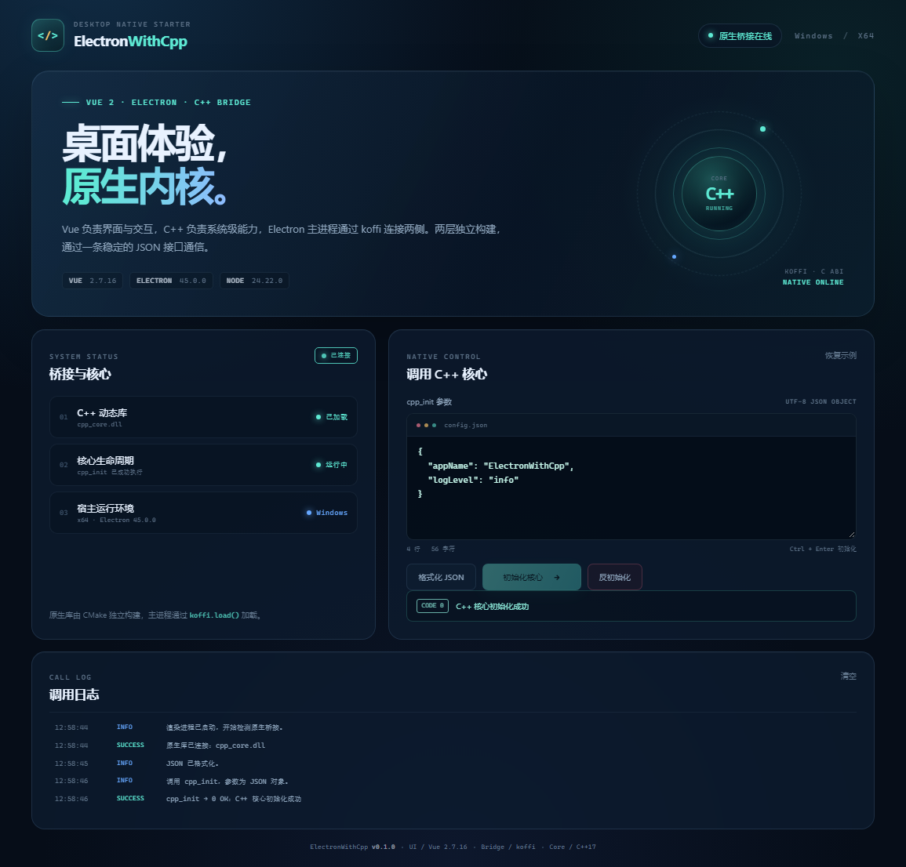

# ElectronWithCpp

一个可直接继续开发的 Electron + Vue 2 + C++ 桌面应用框架。界面层与 C++ 原生层完全独立构建，由 Electron 主进程通过 [koffi](https://koffi.dev/) 连接。

> 当前使用临时名称 `ElectronWithCpp`，正式名称确定后按文末的「改名清单」统一替换即可。



## 技术栈

| 层 | 技术 |
| --- | --- |
| 桌面容器 | Electron 45 |
| 界面 | Vue 2.7 + Vite 7 |
| 原生桥接 | koffi 3.3（C ABI） |
| 原生核心 | C++17 + CMake |
| 打包 | electron-builder 26（Windows NSIS / macOS DMG / Linux AppImage） |

> Vue 2 已进入 EOL，但本项目按需求固定在 Vue 2.7.16。Vue 2 的运行时 API 与构建流程已完整跑通。

## 目录结构

```text
ElectronWithCpp/
├─ electron/                  # Electron 主进程、preload、koffi 桥接
│  ├─ main.js
│  ├─ native-bridge.js
│  └─ preload.js
├─ src/                       # Vue 2 渲染进程
│  ├─ App.vue
│  ├─ main.js
│  └─ styles.css
├─ cpp/                       # C++ 原生层，独立于界面构建
│  ├─ include/cpp_core.h      # 对外 C ABI
│  ├─ src/cpp_core.cpp        # 初始化 / 反初始化实现
│  ├─ scripts/
│  │  ├─ generate-vs2019.bat  # 双击一键生成 VS2019 工程
│  │  ├─ generate-vs2019.ps1
│  │  └─ build.sh             # Linux/macOS 构建
│  ├─ CMakeLists.txt
│  ├─ bin/<platform>/<arch>/  # 编译产物（git 忽略）
│  └─ build/                  # CMake/VS 构建目录（git 忽略）
├─ scripts/                   # 开发启动、原生预构建、接口测试
├─ build/                     # 安装包图标等构建资源
├─ docs/                      # 文档图片
├─ .clang-format              # C++ Allman 大括号风格
└─ electron-builder.config.cjs
```

## 环境要求

- Node.js **22.19.0**（最低 22.12，Vite 7 的要求）
- npm 10+
- Windows：Visual Studio 2019，安装「使用 C++ 的桌面开发」工作负载
- Linux：CMake 3.16+、GCC/Clang
- macOS：Xcode Command Line Tools、CMake 3.16+
- C++ 第三方依赖：RapidJSON（header-only）

Windows 上不要求单独安装 CMake：`scripts/build-native.cjs` 会自动查找 VS2019 自带的 CMake。

本机的第三方库统一放在 `SOLDIERS_3RD` 环境变量指向的目录：

```text
SOLDIERS_3RD=D:\GitResponse\GitHub\ThirdParty
```

当前 C++ 代码从以下位置查找 RapidJSON：

```text
%SOLDIERS_3RD%\rapidjson\include\rapidjson\document.h
```

也可以通过 CMake 参数显式指定：

```powershell
cmake -S cpp -B cpp/build -DRAPIDJSON_INCLUDE_DIR="$env:SOLDIERS_3RD/rapidjson/include"
```

后续新增第三方库时，优先复用 `SOLDIERS_3RD` 中已有的库，不在仓库里重复引入或复制第三方源码。

## 快速开始

```bash
npm install
npm run dev
```

`npm run dev` 会：

1. 通过 `predev` 检查 C++ 源码与动态库时间戳，必要时自动增量构建原生库；
2. 启动 Vite 开发服务器（默认 `http://127.0.0.1:5173`）；
3. 启动 Electron，并加载开发服务器页面。

首次构建 C++ 会慢一些，之后没有源码变更时会直接跳过。

### Electron 下载失败

如果 `npm install` 后 `node_modules/electron/dist/electron.exe` 不存在，通常是 Electron 二进制下载失败。可切换镜像后单独执行安装脚本：

```powershell
$env:ELECTRON_MIRROR = "https://npmmirror.com/mirrors/electron/"
node node_modules/electron/install.js
```

### 受限环境 / CI

本项目的开发用户数据目录放在 `.cache/electron-user-data`，不会污染系统 AppData。

部分 Windows 安全策略、容器或受限终端会阻止 Chromium 创建沙箱，Electron 会在加载应用代码前直接退出，退出码通常为 `2147483651`（`0x80000003`）。开发启动器会自动识别这种启动失败，并用 `--no-sandbox` 重试一次，终端会打印明确警告。因此正常情况下直接运行即可：

```bash
npm run dev
```

也可以手动指定参数，跳过第一次失败：

```powershell
$env:ELECTRON_EXTRA_ARGS = "--no-sandbox"
npm run dev
```

如果不希望开发启动器自动回退，可以设置：

```powershell
$env:ELECTRON_DISABLE_SANDBOX_FALLBACK = "1"
```

`--no-sandbox` 仅用于受限的开发/测试环境，不会写入打包配置，也不影响正式安装包。

## C++ 接口

头文件：`cpp/include/cpp_core.h`

```c
int cpp_init(const char *config_json);
int cpp_deinit(const char *config_json);
```

- 两个接口都只接收一个 UTF-8 JSON 对象字符串，后续可直接增加字段扩展，不需要改变 ABI。
- 调用返回整数状态码，不跨库传递堆内存或 STL 类型。
- 实现内部使用互斥锁保护初始化状态，可安全应对多次调用。
- JSON 最大 64 KiB。

### 参数示例

```json
{
  "appName": "ElectronWithCpp",
  "logLevel": "info"
}
```

```json
{
  "reason": "app-quit"
}
```

### 状态码

| 值 | 名称 | 含义 |
| --- | --- | --- |
| 0 | `CPP_CORE_OK` | 成功 |
| 1 | `CPP_CORE_ERR_INVALID_ARGUMENT` | 参数为空、超长或 JSON 顶层不是对象 |
| 2 | `CPP_CORE_ERR_INVALID_JSON` | JSON 语法无效 |
| 3 | `CPP_CORE_ERR_ALREADY_INITIALIZED` | 重复初始化 |
| 4 | `CPP_CORE_ERR_NOT_INITIALIZED` | 未初始化时调用反初始化 |
| 5 | `CPP_CORE_ERR_INTERNAL` | C++ 内部异常 |

JSON 解析使用 RapidJSON（header-only）。CMake 优先从 `SOLDIERS_3RD/rapidjson/include` 发现头文件，也可通过 `RAPIDJSON_INCLUDE_DIR` 指定；不引入其他 JSON 库，也不在仓库中复制 RapidJSON 源码。

## 构建原生库

```bash
npm run build:native       # 使用 CMake 构建当前平台
npm run test:native        # 通过 koffi 直接验证接口状态码
```

输出位置固定为：

```text
cpp/bin/win32/x64/cpp_core.dll
cpp/bin/linux/x64/libcpp_core.so
cpp/bin/darwin/arm64/libcpp_core.dylib
```

Electron 在开发时从这里加载；打包时 electron-builder 会把它复制到安装包资源目录。

### 一键生成 Visual Studio 2019 工程

双击：

```text
cpp/scripts/generate-vs2019.bat
```

或在命令行运行：

```bash
npm run generate:vs2019
```

生成结果：

```text
cpp/build/electron_cpp_core.sln
```

脚本参数：

```powershell
# 生成并立即编译 Release
.\cpp\scripts\generate-vs2019.ps1 -Build

# 生成、编译并打开 Visual Studio
.\cpp\scripts\generate-vs2019.ps1 -Build -Open

# 指定 Debug
.\cpp\scripts\generate-vs2019.ps1 -Build -Configuration Debug
```

脚本使用 `Visual Studio 16 2019` 生成器与 x64 架构。CMake 输出目录已配置好，编译后的 DLL 会直接落到 `cpp/bin/win32/x64/`。

### Linux / macOS

```bash
bash cpp/scripts/build.sh
# 或者：
cmake -S cpp -B cpp/build -DCMAKE_BUILD_TYPE=Release
cmake --build cpp/build --parallel
```

跨平台发布时，请分别在对应操作系统上构建原生库和安装包，不要在 Windows 上交叉编译 macOS/Linux 的 C++ 核心。

## Electron 与 koffi 桥接

调用链：

```text
Vue 组件
  → window.cppBridge (preload, contextBridge)
  → ipcRenderer.invoke
  → Electron 主进程 native-bridge.js
  → koffi
  → cpp_core 动态库
```

安全设置：

- `nodeIntegration: false`
- `contextIsolation: true`
- `sandbox: true`
- 渲染进程只能访问 preload 白名单中的 `getStatus` / `initialize` / `deinitialize`
- 页面加载了 CSP，不允许内联脚本执行

koffi 只在主进程加载，渲染进程不直接接触 Node.js 或原生库。

### 加载路径

| 场景 | 路径 |
| --- | --- |
| 开发 | `cpp/bin/<platform>/<arch>/<native library>` |
| 打包后 | `resources/native/<native library>` |
| 手动覆盖 | 环境变量 `CPP_CORE_LIBRARY` |

## 打包

```bash
npm run pack          # 生成免安装目录 release/win-unpacked
npm run dist:win      # 生成 Windows NSIS 安装包
npm run dist:mac      # 生成 macOS DMG（需在 macOS 执行）
npm run dist:linux    # 生成 Linux AppImage（需在 Linux 执行）
```

打包前会自动构建渲染进程和原生库。配置位于 `electron-builder.config.cjs`：

- `appId` / `productName`：当前为临时值
- Windows：NSIS、x64、可选安装目录、桌面/开始菜单快捷方式
- 原生库：通过 `extraResources` 放入 `resources/native`
- koffi：通过 `asarUnpack` 解包 `.node` 文件
- 图标：`build/icon.ico`、`build/icon.png`

当前未配置代码签名与 macOS 公证。正式发布前需要补上证书、签名和自动更新策略。

## 常用命令

| 命令 | 作用 |
| --- | --- |
| `npm run dev` | 开发模式（自动预构建 C++） |
| `npm run build` | 构建 Vue 渲染进程到 `dist/renderer` |
| `npm run build:native` | 构建当前平台 C++ 动态库 |
| `npm run test:native` | 用 koffi 调用原生接口并验证状态码 |
| `npm run generate:vs2019` | 生成 VS2019 解决方案 |
| `npm run start` | 运行已构建的页面（需先执行 `npm run build` 和 `npm run build:native`） |
| `npm run pack` | 生成未打包目录 |
| `npm run dist` | 打包当前平台安装包 |
| `npm run dist:win` | 打包 Windows NSIS 安装包 |

## 改名清单

正式名称确定后，至少修改以下位置：

1. `package.json`：`name`、`version`、`description`
2. `electron/main.js`：`APP_ID`、`PRODUCT_NAME`，并同步 `app.setAppUserModelId`
3. `electron-builder.config.cjs`：`appId`、`productName`、`shortcutName`、`uninstallDisplayName`
4. `index.html`：`<title>`
5. UI 文案：`src/App.vue` 中的品牌名
6. `README.md`、`build/icon.ico`、`build/icon.png`
7. 如需要，修改 C++ 工程名 `cpp/CMakeLists.txt` 中的 `project(...)`（会改变生成的 `.sln` 名称）

`appId` 建议使用反向域名，例如 `com.yourcompany.yourapp`。

## 故障排查

### 提示「未找到 C++ 动态库」

```bash
npm run build:native
```

如果仍然失败，检查 `cpp/bin/<platform>/<arch>/` 下是否存在对应文件，以及当前 Electron 是否为 x64。

### CMake 找不到 C++ 编译器

确认 VS2019 安装了「使用 C++ 的桌面开发」工作负载，并且 `VC\Tools\MSVC` 目录存在。脚本会自动定位 VS2019 自带的 CMake。

### `npm run dev` 中 Electron 立即退出

- 退出码 `2147483651` / `0x80000003` 表示 Chromium 沙箱初始化失败，开发启动器会自动用 `--no-sandbox` 重试。
- 其他退出码请查看终端里的主进程日志；开发模式会输出退出码。
- 确认 `node_modules/electron/dist/electron.exe` 存在。

### 原生库修改后没有生效

`npm run dev` 会按源码时间戳自动增量构建。也可以强制执行：

```bash
npm run build:native
```

然后重新启动应用。已经加载的 DLL 在进程退出前不会被替换。
